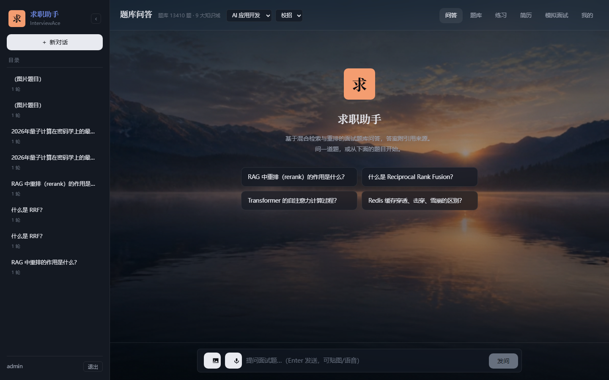
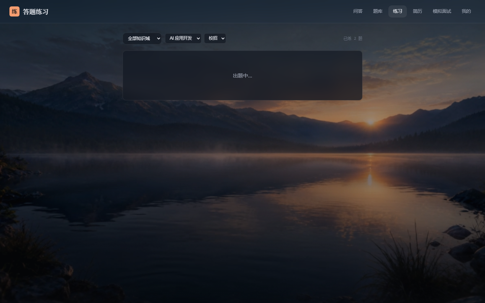
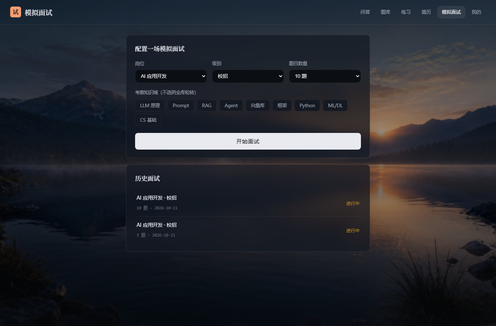
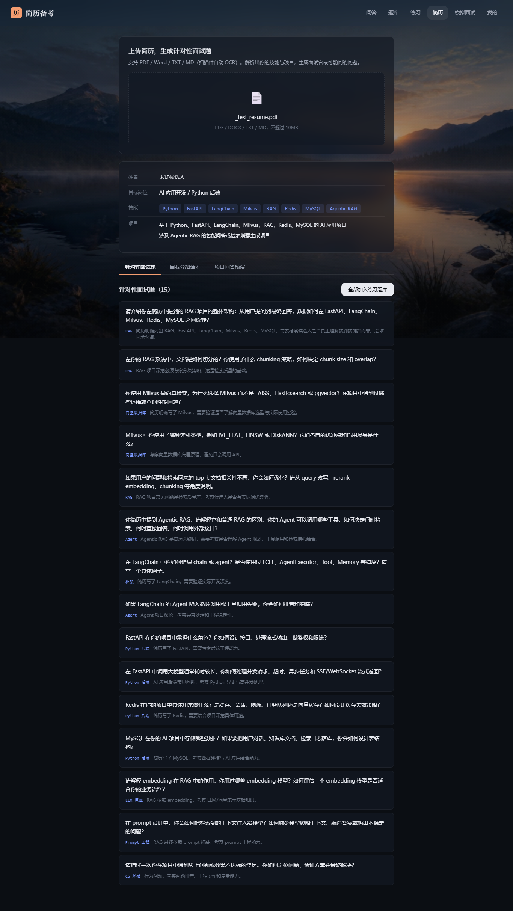
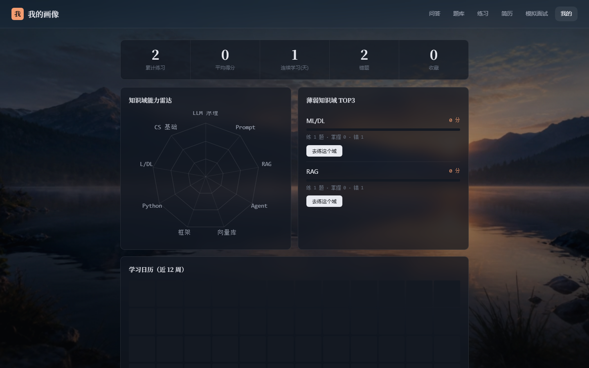

# 求职助手（InterviewAce）

面向 **实习 / 校招 / 社招** 的求职备战训练平台 —— 不只是问答，而是「**学 → 练 → 测 → 评**」的完整闭环。


---

## 界面预览

| 题库问答（检索来源可展开） | 答题练习（AI 评分） | 模拟面试 |
|---|---|---|
|  |  |  |

| 题库总览 | 简历备考 | 能力画像 |
|---|---|---|
|  |  |  |

---

## 核心能力

| 模块 | 能力 |
|---|---|
| **学 · 题库问答** | 混合检索 + 重排，流式作答，答案带 `[1][2]` 引用；每条来源可展开看命中的知识块 |
| **学 · 题库外兜底** | 题库未收录时自动**联网检索**作答，并记入「待补题池」，可一键生成答案入库（题库自增长） |
| **练 · 答题练习** | 抽题 → 自答 → **AI rubric 三维评分**（准确性/深度/表达）+ 遗漏点 + 参考答案对比；答错自动进错题本 |
| **测 · 模拟面试** | 状态机驱动的 AI 面试官：出题 → 评分 → **追问**（低分澄清式 / 高分深挖式）→ 总评报告（四维雷达 + 薄弱域） |
| **评 · 能力画像** | 9 大知识域雷达图、薄弱 TOP3、学习日历热力图、错题本/收藏 |
| **多模态** | 图片问答（传题目截图直接作答）、上传简历生成针对性面试题 |
| **语音** | **实时语音输入**：豆包流式 ASR，边说边出字 |
| **个性化** | 岗位切换（AI 应用开发 / Python 后端 / AI 算法）× 级别（实习 / 校招 / 社招），自动调整选题难度与评分严格度 |
| **长期记忆** | 学习画像注入生成 prompt：薄弱域的讲解自动多铺垫基础，强项直接切原理 |

---

## 架构

```
前端 Vue3 + Vite + Pinia（深色玻璃拟态 · 全局视频背景）
   │  HTTP / SSE / WebSocket
   ▼
FastAPI 网关（JWT · 限流 · 并发背压 · Prometheus · 健康探针）      ← 8002
   │
   ├─ tasks: 问答 / 练习评分 / 模拟面试 / 简历备考 / 实时语音
   │
   ▼
检索层：稠密(qwen 2048d) + 稀疏(bge-m3 本地)
   → 加权 RRF(0.8:0.2) → q_type|source|title 去重 → bge-reranker 重排
   → domain / position / difficulty 标量过滤 + 召回不足自动跨域
   │
   ├─ Milvus interview_kb（13 字段 · 按 q_type 分区 · 父子块）
   └─ MySQL interviewace_db（12 张表：用户/会话/练习/收藏/待补题/面试/简历…）
```

**几个设计取舍**
- **QA 对整块不切**：子块 = 题干（与用户提问同分布，检索最准），父块 = 题干 + 完整答案（喂给 LLM）
- **状态存 MySQL，不用内存 checkpointer**：模拟面试每轮独立执行，重启/刷新不丢现场，多实例天然安全
- **评分必带检索出的参考答案**：让「AI 点评」有据可依，而不是凭模型记忆
- **练习抽题不走向量检索**：标量过滤直抽（~50ms），把重排留给真正需要语义匹配的问答

---

## Java 企业级后端（backend-java/）

在原 FastAPI 版本稳定运行后，**用 Spring Boot 3 完整重写了后端**（同一前端、同一数据库、同一 API 契约，可灰度切换）：

```
Spring Boot 3.3 + Java 21 + MyBatis-Plus + Flyway + Redis + JWT + Milvus SDK
   ├─ 与 Python 版互通：BCrypt 密码哈希免迁移、JWT HS256 同构、snake_case JSON 契约
   ├─ 完整移植：SSE 流式问答（意图分析→检索改写重试→联网兜底）、图片问答（多模态）、
   │            练习评分、面试追问状态机、简历解析、长期记忆注入、待补题池自增长
   ├─ 工程加固：Flyway 迁移、Redis 分布式限流（降级进程内）、审计日志、Actuator + Prometheus
   └─ 34 个测试：Service 单测（Mockito）+ Controller 契约测试（standalone MockMvc）
                 + Mapper 回归测试（H2 内存库跑真实 SQL）
```

**检索质量回归评测**（同一金标集 60 条、同一口径，脚本 `backend-java/scripts/eval_retrieval.py`）：

| 指标 | Java 稠密+云端重排（qwen3.7-text-rerank） | Python 纯稠密 | Python 混合+本地重排 |
|---|---|---|---|
| Recall@1 | 0.917 | 0.917 | 0.933 |
| Recall@10 | **1.000** | 0.950 | 0.950 |
| MRR@10 | **0.941** | 0.928 | 0.937 |
| nDCG@10 | **0.955** | 0.934 | 0.940 |

Java 版未移植本地稀疏/重排模型，改用 DashScope 云端 rerank API——Recall@10 满分，MRR/nDCG 反超本地重排链路。

```bash
cd backend-java && mvn test          # 跑测试（无外部依赖）
mvn package && java -jar target/interviewace-backend-1.0.0.jar   # 起服务（:8002）
```

---

## 快速开始

### 本地开发

```bash
# 1. 基础设施（共享 rag-* 容器栈）
docker compose up -d
docker compose -f docker-compose-vis.yml up -d   # 可选：phpMyAdmin(8080) + Attu(8001)

# 2. 配置
cp .env.example .env      # 填 QWEN_API_KEY（豆包 ASR 的 VOLC_ASR_API_KEY 可选，不加则不启用语音）

# 3. 依赖
pip install -r requirements.txt

# 4. 题库入库（首次；幂等，可反复跑）
python scripts/ingest_all.py

# 5. 后端
python app.py             # → http://localhost:8002

# 6. 前端
cd frontend && npm install && npm run dev   # → http://localhost:5173
```

默认账号 **admin / admin123**（可注册新号）。

### Docker 一键起应用栈

```bash
docker compose up -d                              # 先起基础设施
docker compose -f docker-compose.app.yml up -d --build
# 前端 http://localhost:8088
```

---

## 评测

> 完整报告与口径说明见 [`docs/EVALUATION.md`](docs/EVALUATION.md)

**检索策略对比**（60 条口语化改写 query，对比 5 种策略）

| 策略 | Recall@1 | Recall@10 | MRR@10 | nDCG@10 |
|---|---|---|---|---|
| dense_only（纯稠密） | 0.917 | 0.950 | 0.928 | 0.934 |
| sparse_only（纯稀疏） | 0.750 | 0.833 | 0.789 | 0.800 |
| hybrid_rrf（混合，不重排） | 0.833 | 0.950 | 0.869 | 0.888 |
| **hybrid_rerank（混合+重排）** | **0.933** | **0.950** | **0.937** | **0.940** |

**召回率 95.0% ｜ 命中率 95.0% ｜ 首位命中 93.3% ｜ MRR 0.937**

三个结论：① **重排收益最大**（Recall@1 比纯稠密高 1.6pt）；② **稀疏通道在中文口语化查询上是噪声源**——`hybrid_rrf` 反而低于纯稠密，是重排把损失补了回来；③ 剩余 5% 漏召来自改写幅度过大的查询，优化方向是查询扩展与题库同义问法。

**生成质量 & 评分一致性**

| 评测 | 结果 |
|---|---|
| 生成正确性（LLM-as-Judge） | **4.8 / 5** |
| 生成忠实度（是否 grounded） | **4.3 / 5** |
| 幻觉率 | **10%**（10 条中 1 条，报告已定位到具体样例） |
| AI 评分一致性（Spearman 秩相关） | **0.822** |
| 评分分档均分 | 好 89.7 / 中 57.5 / 差 12.5 |

**CI 回归门禁**：指标跌超 3% 阻断合并，已接入 GitHub Actions。

```bash
python -m interviewace.evaluation.build_golden --n 100 --rewrite   # 建金标集
python -m interviewace.evaluation.eval_retrieval --tier B --limit 60
python -m interviewace.evaluation.eval_answer --n 10
python -m interviewace.evaluation.eval_scoring --n 6
python scripts/eval_gate.py --update-baseline                      # 记录基线
```

---

## 技术栈

**后端**：FastAPI · Uvicorn · Pydantic · SQLAlchemy + PyMySQL · pymilvus · LangChain · LangGraph · tenacity · PyJWT · passlib · prometheus-client

**检索 / 模型**：
| 环节 | 模型 |
|---|---|
| 稠密嵌入 | `qwen3.7-text-embedding`（DashScope，2048 维） |
| 稀疏嵌入 | `BAAI/bge-m3`（本地，lexical weights） |
| 重排 | `BAAI/bge-reranker-v2-m3`（本地 CrossEncoder） |
| 生成 / 评分 | `qwen3.8-2.4t-a95b`（DashScope） |
| 裁判 / 联网 / 读图 | `qwen3.8-max`（DashScope，多模态） |
| 语音识别 | **豆包流式语音识别 2.0**（火山引擎，WebSocket 流式） |

**前端**：Vue 3 · Vite · Pinia · Vue Router · axios · marked + DOMPurify · Web Audio API（实时语音采集）· WebSocket

**基础设施**：Docker Compose（Milvus + MySQL + etcd + MinIO）· pytest（32 测试）· GitHub Actions

---

## 项目结构

```
InterviewAce/
├── backend-java/         # Java 后端（企业级重写版）：controller / service / mapper / security
│   └── src/test/         #   34 测试：Service 单测 + Controller 契约 + Mapper H2 回归
├── interviewace/         # Python 后端（原版）
│   ├── backend/          #   FastAPI（main/auth/config/logger/metrics/ratelimit/health）
│   │   ├── cache.py      #     进程内 TTL+LRU 缓存（embedding / LLM 响应）
│   │   └── database/     #     milvus.py（schema）/ mysql.py（12 张表）
│   ├── rag/              #   embedding / retriever / ingest / qa_ingest
│   ├── services/         #   qa / practice / interview / resume / stt / question_selector
│   └── evaluation/       #   评测脚本 + 金标集 + baseline + report
├── data_pipeline/        # 数据管线（schema/dedup/stats/qc_judge/taxonomy + 10+ 个 ETL）
├── frontend/             # Vue3 + Vite（登录/问答/题库/练习/简历/面试/画像）
├── scripts/              # ingest_all / eval_gate / create_user
├── tests/                # 21 单测 + 11 集成测试
├── prometheus/           # 告警规则
└── Dockerfile · docker-compose*.yml · .github/workflows/ci.yml
```

---

## 数据集

13,411 条题库（问答 5,631 + 知识短文 7,780），来源：开源真题 9,501 + LLM 生成 3,910，覆盖 9 大知识域。

| 来源 | 内容 | 合规 |
|---|---|---|
| [ather-techie/rag-interview-system](https://github.com/ather-techie/rag-interview-system) | RAG 专项 QA | MIT |
| [xiaolincoder/CS-Base](https://github.com/xiaolincoder/CS-Base) · [Snailclimb/JavaGuide](https://github.com/Snailclimb/JavaGuide) | MySQL/Redis/网络/OS | 仅提炼题目，不开源原始内容 |
| [wdndev/llm_interview_note](https://github.com/wdndev/llm_interview_note) · KalyanKS / Lau-Jonathan / MisterBooo / km1994 / GongLingRui / taizilongxu / 315386775 | LLM/Agent/RAG/Python/DL 面试题 | 只提炼题目，答案 LLM 自撰 |
| LLM 知识点穷举生成 | 9 域 × 3 难度梯度 | 标记 `generated=true` |

数据管线：ETL 抽取 → 统一 JSONL（pydantic 校验门禁）→ 三级去重（content_hash + 题干归一化 + Jaccard）→ LLM 质检抽检 → 双通道嵌入 → 幂等入库。

---

## 测试与 CI

```bash
pytest tests/            # 21 单测（纯函数）+ 11 集成测试（依赖不可用自动 skip）
python scripts/eval_gate.py   # 评测回归门禁
```

GitHub Actions 四个 job：Python 单元测试 + 编译检查 / 评测回归门禁 / Java 后端测试（34 个）/ 前端构建。

---

## 许可与免责

仅用于个人学习与面试准备。题库来源已标注；面经类内容只提炼题目、不存储原文；LLM 生成内容均带 `generated` 标记。`data/` 目录不入库。
