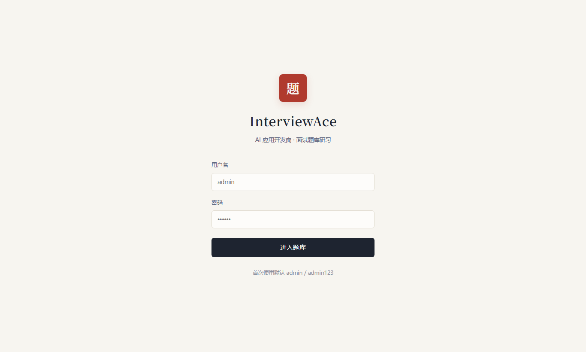
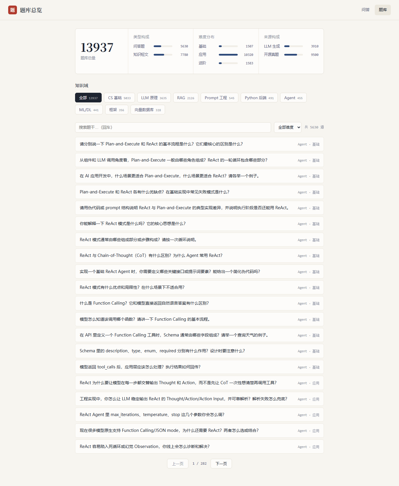
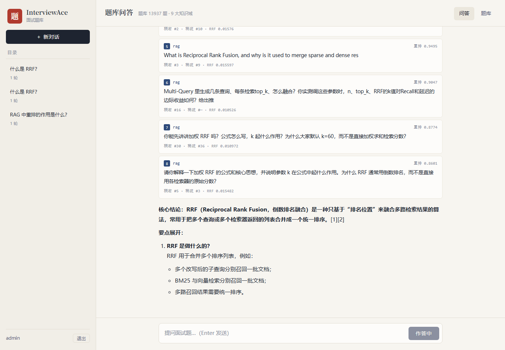

# InterviewAce — 实习面试助手（RAG 系统）

面向 **AI 应用开发实习岗**（LLM/RAG/Agent 方向）的面试备战系统，同时也是 RAG/Agent 方向的作品集项目。

**两大功能**：面试题库智能问答（带引用来源）・ 模拟面试对练（规划中）


---

## 快速开始

### 0. 前置条件

- Docker Desktop（跑 Milvus + MySQL）
- Python 3.10+（推荐用项目自带的 `.venv`）
- Node.js 18+（前端）
- 通义千问 API Key（[DashScope](https://dashscope.console.aliyun.com/) 申请）

### 1. 启动基础设施（只需一次）

```bash
cd d:/项目/InterviewAce
docker compose up -d            # MySQL + Milvus（共享 rag-* 容器栈）

# 可选：数据库可视化
docker compose -f docker-compose-vis.yml up -d
#   phpMyAdmin → http://localhost:8080  (root / 123456)
#   Attu       → http://localhost:8001
```

> ⚠️ compose 项目名统一为 `enterprise-kb`（共享栈幂等接管的关键）；**任何时候不要加 `--remove-orphans`**，会误删其他项目共用的容器。

### 2. 启动后端（端口 8002）

```bash
cd d:/项目/InterviewAce

# 2.1 配置（首次）
cp .env.example .env
#   编辑 .env，填入 QWEN_API_KEY
#   HF_HOME 已指向 SmartQuery 的模型缓存（bge-m3 / bge-reranker-v2-m3 免下载）

# 2.2 安装依赖（首次）
pip install -r requirements.txt

# 2.3 题库入库（首次；幂等，可反复跑）
python scripts/ingest_all.py
#   首次启动会自动建库建表建集合，无需手动执行 DDL

# 2.4 启动服务
python app.py
```

启动后验证：

```bash
curl http://localhost:8002/health   # {"status":"ok","service":"InterviewAce"}
curl http://localhost:8002/ready    # milvus/mysql/embedding 三项 true
```

### 3. 启动前端（端口 5173）

```bash
cd d:/项目/InterviewAce/frontend

npm install        # 首次
npm run dev        # 开发模式（Vite 已配好 /api 代理到 8002）
```

打开 **http://localhost:5173** → 用默认账号 **admin / admin123** 登录。

- **问答页**（`/chat`）：提问 → 意图分析 → 混合检索 → 流式作答。每条答案附**思考过程**与**检索来源**（含稠密/稀疏/RRF/重排分数）。
- **题库页**（`/bank`）：题库总量、类型/难度/来源构成、9 大知识域分布，题目可按域/难度筛选、搜索题干、展开看答案。

生产构建：`npm run build`（产物在 `frontend/dist/`）。

## 界面预览

| 登录 | 题库总览 | 问答 |
|---|---|---|
|  |  |  |

### 4. 测试

```bash
cd d:/项目/InterviewAce
pytest tests/      # 21 个单测
```

---

## 数据管线（题库怎么来的）

```bash
# ETL：开源仓库 → JSONL（各源脚本独立，跑过的可跳过）
python data_pipeline/sources/github_ather_techie.py   # RAG 专项题库（英文 1352 题）
python data_pipeline/sources/github_km1994.py         # 中文 LLM 题干种子
python data_pipeline/sources/github_misterbooo.py     # 图解面试题种子
python data_pipeline/sources/github_gonglingrui.py    # Agent/RAG 面经题
python data_pipeline/sources/github_taizilongxu.py    # Python 八股
python data_pipeline/sources/github_kalyanks.py       # 英文 RAG QA
python data_pipeline/sources/github_laujonathan.py    # 大模型+Agent 指南 + 字节真题
python data_pipeline/sources/github_dl_awesome.py     # 深度学习/AIGC 面试题
python data_pipeline/sources/github_wdndev.py         # LLM 教程 → 知识短文
python data_pipeline/sources/github_csbase.py         # 图解 MySQL/Redis/网络/OS
python data_pipeline/sources/github_javaguide.py      # MySQL/Redis/网络（跳过 Java 部分）

# LLM 批量出题（主力产能，断点续跑，可随时中断重来）
python data_pipeline/sources/llm_generate.py --mode taxonomy   # 9 域 × 知识点 × 3 难度
python data_pipeline/sources/llm_generate.py --mode seeds      # 给种子题干补答案

# 校验 + 三级去重 + 入库（幂等）
python scripts/ingest_all.py

# 报表与质检
python data_pipeline/stats.py                          # 知识域 × 难度 × 来源分布
python data_pipeline/qc_judge.py                       # 裁判模型抽检 10%（通过率 <90% 报警）
```

> 生成模型通过 `.env` 的 `QWEN_MODEL` 配置；生成内容标记 `generated=true`，知识库抽取的真题标记 `generated=false`，报表可按此区分。

---

## 端口与服务地图

| 端口 | 服务 | 说明 |
|---|---|---|
| **5173** | **前端（Vite dev）** | `npm run dev` |
| **8002** | **后端（FastAPI）** | `python app.py` |
| 8000 | SmartQuery 后端 | 另一个项目 |
| 8001 | Attu（Milvus 可视化） | `docker-compose-vis.yml` |
| 8080 | phpMyAdmin（MySQL 可视化） | root / 123456 |
| 3306 | 共享 MySQL（rag-mysql） | 本项目库：`interviewace_db` |
| 19530 | 共享 Milvus（rag-milvus） | 本项目集合：`interview_kb` |

**数据隔离**：与其他项目共用同一套数据库服务器，MySQL 按库名隔离、Milvus 按集合名隔离，互不读写。

---

## 架构

```
前端 Vue3 + Vite（5173）
   │  HTTP / SSE
   ▼
FastAPI 网关（8002）  JWT 认证 / 限流 / Prometheus / 健康探针
   │
   ├─ services/qa_service        题库问答 LangGraph（意图路由 + domain 识别 + 自省改写重检）✅
   ├─ services/interview_service 模拟面试状态机（状态存 MySQL，每轮独立 invoke）🚧
   └─ services/resume_service    简历备考三链路（话术/预演/预测）⬜
   │
   ▼
检索层 rag/retriever：稠密(qwen 2048d) + 稀疏(bge-m3 本地)
   → 加权 RRF(0.8:0.2) → q_type|source|title 去重 → bge-reranker-v2-m3 重排
   → domain/q_type/difficulty/company 标量过滤 + 召回不足自动跨域 fallback
   │
   ├─ Milvus interview_kb（父子块：子块检索 / 父块作答；按 q_type 分区）
   └─ MySQL interviewace_db（用户/会话/审计/反馈/token 预算）
```

**问答链路**：`query_analysis`（意图分类 + 知识域识别 + 检索词改写）→ `retrieve`（标量过滤混合检索）→ 重排分 < 0.5 时 `rewrite` 改写重检（≤3 轮）→ `generate`（框架化作答 + [1][2] 引用 + 相似真题推荐）。

---

## 数据集

| 来源 | 内容 | 量级 | 合规 |
|---|---|---|---|
| [ather-techie/rag-interview-system](https://github.com/ather-techie/rag-interview-system) | RAG 专项 QA（52 专题） | 1352 | MIT |
| [xiaolincoder/CS-Base](https://github.com/xiaolincoder/CS-Base) | 图解 MySQL/Redis/网络/OS | 699 | 仅个人学习，不开源原始内容 |
| [Snailclimb/JavaGuide](https://github.com/Snailclimb/JavaGuide) | MySQL/Redis/网络（已剔除 Java 专属） | 868 | 同上 |
| [wdndev/llm_interview_note](https://github.com/wdndev/llm_interview_note) | LLM 教程知识短文 | 553 | 同上 |
| [KalyanKS-NLP/RAG-Interview-…-Hub](https://github.com/KalyanKS-NLP/RAG-Interview-Questions-and-Answers-Hub) | 英文 RAG QA | 105 | 同上 |
| [Lau-Jonathan/LLM-Agent-Interview-Guide](https://github.com/Lau-Jonathan/LLM-Agent-Interview-Guide) | 大模型+Agent 指南、字节真题 | 100 + 102 种子 | 只提炼题目 |
| [MisterBooo/llm-interview-questions](https://github.com/MisterBooo/llm-interview-questions) | 图解面试题（种子） | 100 种子 | 只取题干，答案 LLM 自撰 |
| [km1994/LLMs_interview_notes](https://github.com/km1994/LLMs_interview_notes) | 中文 LLM 题干清单（种子） | 333 种子 | 不复制其付费专栏 |
| 其他（GongLingRui / taizilongxu / 315386775） | Agent 面经 / Python 八股 / DL 面试题 | 300+ | 同上 |
| LLM 知识点穷举生成 | 9 知识域 × 3 难度梯度 | ~4000 | 标记 `generated=true` |

**当前规模**：JSONL **7806 条**（QA 6226 + 知识短文 1580），覆盖全部 9 个知识域：

| 知识域 | 条数 | 知识域 | 条数 |
|---|---|---|---|
| rag | 2043 | prompt | 481 |
| cs_basic | 1923 | ml_dl | 441 |
| llm_basics | 1432 | agent | 376 |
| python_backend | 491 | framework | 312 |
| | | vectordb | 307 |

**数据管线**：ETL 抽取 → 统一 JSONL 中间格式（pydantic 校验门禁）→ 三级去重（content_hash + 题干归一化 + Jaccard 近重复）→ LLM 抽检质检 → 双通道嵌入 → 幂等入库（按 source 先删后插）。QA 对整块不切（子块 = 题干，父块 = 题干 + 答案）；知识短文父子分块。

---

## 项目结构

```
InterviewAce/
├── app.py                      # 后端入口（8002）
├── docker-compose.yml          # 共享基础设施栈（enterprise-kb 项目名）
├── docker-compose-vis.yml      # 可视化（phpMyAdmin + Attu）
├── interviewace/
│   ├── backend/                # main/auth/config/logger/metrics/ratelimit/health
│   │   └── database/           # milvus.py（interview_kb schema）/ mysql.py
│   ├── rag/                    # embedding / retriever / ingest / qa_ingest
│   ├── services/               # qa_service ✅ / interview / resume / question_selector
│   └── evaluation/             # 检索评测 / LLM-as-Judge / 评分一致性
├── data_pipeline/              # schema / dedup / stats / qc_judge / taxonomy / sources/*(ETL)
├── data/                       # raw(原始克隆) jsonl(中间格式) resumes/  ← 不开源
├── scripts/                    # ingest_all / create_user / eval_gate
├── frontend/                   # Vue3 + Vite（登录 / 聊天问答）
└── tests/                      # 21 个单测
```

---

## 开发进度

| 里程碑 | 内容 | 状态 |
|---|---|---|
| **M0 地基** | 基础设施 / 复用模块搬迁 / Milvus 新 schema / 21 单测 | ✅ |
| **M1 题库问答** | 7800+ 条题库 + LangGraph 问答链路 + SSE + Vue 前端 | ✅ |
| M2 模拟面试 | 状态机 / 追问 / 四维评分 / 房间+报告页 | 🚧 |
| M3 简历备考 | 上传解析 / 自我介绍 / 项目预演 / 预测题 | ⬜ |
| M4 评测体系 | 检索多策略评测 / LLM-as-Judge / CI 门禁 / 万级题库 | ⬜ |

## 设计文档

完整设计（架构规划表 / 并发设计 / 企业级入库管线 / 前端排版 / 风险取舍）见桌面：
《InterviewAce-设计方案.md》《InterviewAce-设计答疑与企业级对标.md》

## 许可与免责

本项目仅用于个人学习与面试准备。题库来源已在上方标注；面经类内容只提炼题目、不存储原文；
LLM 生成内容均带 `generated` 标记。`data/` 目录不入库不开源。
